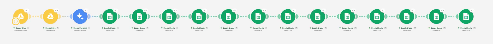

# Memo-to-Screening Automation (Make.com + Google Gemini)

A low-code workflow that reads an **investment memo**, extracts the key deal information with an LLM, and fills in an
investor's **deal-screening template** automatically. I built it for an AI Analyst technical case study, using a
fictitious agri-finance company (*AgriWave Ltd*).



## The problem

When a memo arrives, an analyst copies the company profile, funding request, impact credentials and several years of
financials into a screening spreadsheet by hand. This is slow and repetitive, and it's easy to make a copy error.

## How it works

| # | Module | What it does |
|---|---|---|
| 1 | Google Drive: *Watch Files in a Folder* | Starts when a new memo lands in an intake folder |
| 2 | Google Drive: *Download a File* | Converts the memo (Google Doc) to plain text |
| 3 | Google Gemini AI: *Generate a response* | `gemini-3.6-flash` in **JSON response mode** extracts a fixed schema of fields |
| 4–16 | Google Sheets: *Update a Cell* ×13 | Writes each field into its exact cell in the screening template |

Design choices:

- **Structured output instead of free text.** Gemini's JSON mode returns typed fields, so no separate parsing module is needed.
- **No guessing.** The prompt tells the model to return `null` when a value isn't stated, and to report contradictions in a
  `data_quality_flags` array. In testing it caught a real one: the memo's intro and its funding section disagree on the
  debt/equity split.
- **Dropdown-safe values.** Categorical answers (climate alignment, gender-lens alignment, country) are restricted to the
  template's own list values, so the template's lookups, such as country risk tier, resolve automatically.
- **Arrays to cells.** Multi-year figures come back as arrays and are mapped with `{{get(3.result.revenue; n)}}`.
- **The human stays in the loop.** The AI extracts; the analyst confirms the flags and makes the judgement calls, such as risk scores.

## What the analysis found

Reconciling the source financial statements turned up several issues that the screening flagged for due diligence:

- The forecast balance sheet doesn't balance as presented, and the current-liability lines don't sum to the stated subtotal.
- EBITDA line items don't add up to the reported EBITDA in three of five years.
- The cash flow statement doesn't reconcile to the change in cash in any year.
- A headline "capital efficiency" claim used the loan book as its denominator (about 32%). On equity + debt it is about 22%.
- The implied loan yield is above 200% on the average loan book, which warrants a deep dive into pricing and portfolio quality.

## Repository

```
workflow/
  make_blueprint.json     Make.com scenario export (IDs and connections removed; import and reconnect your own)
  extraction_prompt.txt   The Gemini prompt and its design notes
  field_mapping.csv       JSON field -> template cell mapping, including fields for a full-statement extension
  sample_output.json      Example of the structured output
scripts/                  Python helpers I used to record and caption the demo video (Windows, ffmpeg)
  ctl.py                  Mouse, keyboard and screenshot helper (ctypes + Pillow)
  rec.py                  Records each demo scene with ffmpeg gdigrab while ctl.py drives the browser
  build.py                Trims scenes, burns in captions, joins them into one MP4
docs/make_scenario.png
```

### Run it yourself

1. In Make.com, use **Create scenario → … → Import Blueprint** and choose `workflow/make_blueprint.json`.
2. Reconnect Google Drive, Google Sheets and Google Gemini AI. A free API key from aistudio.google.com is enough.
3. Point module 1 at your intake folder and the Sheets modules at your copy of the template.
4. Drop a memo (opened as a Google Doc) into the folder and click **Run once**.

## Limitations and next steps

- The demo automates the 13 headline fields. Extending it to every statement line means adding fields to the prompt and Sheets modules; no code is needed.
- LLM APIs can return `503` (high demand). Next step: a *Break* error handler with automatic retries.
- Next steps also include writing the model's data-quality flags into the sheet automatically, logging each run to a deal register, and adding per-field confidence scores.

---
Built by **Victor Kiptum**. The company and figures are fictitious and come from a case-study brief.
